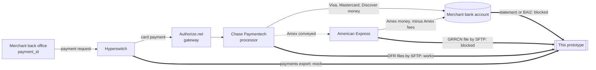
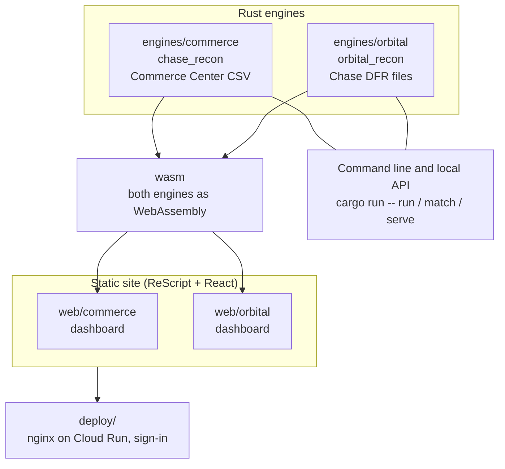
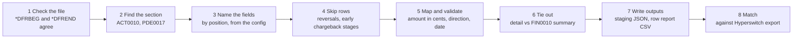
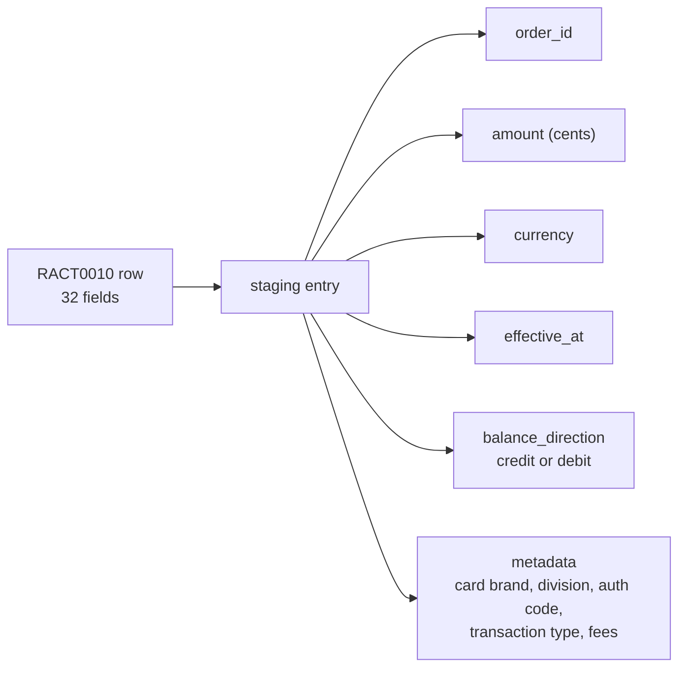

# Chase settlement recon prototype

A prototype that reconciles Chase (J.P. Morgan) settlement files with Hyperswitch, built for a
toll-road merchant whose card payments go through Authorize.net to Chase. The engines are written in **Rust**. They read Chase's files, turn every row into a
standard staging entry, check the rows against Chase's own daily summary, and match them against a
Hyperswitch export.

One static site has two dashboards:

- **Commerce dashboard**: drop a J.P. Morgan Commerce Center CSV report (Deposit Details, fees).
- **Orbital dashboard**: drop a Chase Paymentech Delimited File Report (DFR, `.dfr` or
  `.dfr_resp`).

Both dashboards run the Rust engines **in the browser as WebAssembly**, so the site needs no
server. Nothing you drop leaves your browser.

## Status (October 2026)

| What | State |
|---|---|
| Chase DFR files (ACT0010 deposits, FIN0010 daily summary, PDE0017 chargebacks) | Works. Checked against a live DFR file: 9,186 of 9,186 deposit rows staged, every card brand ties to FIN0010. |
| Chase Commerce Center CSV reports | Works on J.P. Morgan's public sample reports. |
| Amex conveyed | Detected. Chase marks Amex as conveyed (`C`), funds none of it and charges no fees on it. The dashboard shows the conveyed total apart from Chase's deposit. |
| Amex's own settlement file (GRRCN) | **Blocked**: needs a sample and an SFTP setup from American Express. |
| Bank statement (the merchant's deposits) | **Blocked**: needs bank access (statement API or BAI2 file). |
| Hyperswitch export | Mock, with differences planted on purpose. |
| Tests | `cargo test --workspace`: Commerce 32, Orbital 54, wasm 1. |

## Where the data comes from

A card payment moves money on one path and data on another. Recon has to close three legs: what
Chase reports, what Amex reports for the conveyed Amex payments, and what landed in the bank.



The join key is the merchant's `payment_id`. It is 30 characters, but Chase keeps only 22 characters
of the merchant order number, and Authorize.net's invoice number holds 20. Which ID Chase prints for
Authorize.net payments is still an open question.

## Architecture



| Path | What it is |
|---|---|
| `engines/commerce` | Rust engine for Commerce Center CSV reports (`chase_recon`) |
| `engines/orbital` | Rust engine for Chase DFR files (`orbital_recon`), with the tie-out to Chase's own summary. See its [README](engines/orbital/README.md). |
| `engines/*/configs` | One JSON config per report: which section, which field is which, what to skip |
| `engines/*/samples` | Sample files. Commerce: J.P. Morgan's public samples. Orbital: synthetic. |
| `wasm` | Both engines as WebAssembly functions for the dashboards |
| `web/commerce`, `web/orbital` | The dashboards (ReScript + React, Hyperswitch Control Center look) |
| `web/index.html` | Start page: opens the Orbital dashboard. The Commerce dashboard is behind the sidebar's **More pages** button. |
| `scripts/build.sh` | Builds everything into `dist/` |
| `deploy/` | Cloud Run deploy (nginx, username + password) |

## How a Chase DFR file is processed

A DFR file is not one table. It is a stack of reports, and the first field of each line says what
the line is. The Orbital engine runs eight steps. The dashboard shows each step, what it did to the
file, and how long it took.



| Step | File | What it does |
|---|---|---|
| 1 to 3 | `src/dfr.rs` | Checks the frame, reads the delimiter (comma, pipe or tab), lists the sections, names each field from the config. Rejects a cut-off file whole. |
| 4 | `src/skip.rs` | Drops rows the config names, each with a reason. |
| 5 | `src/transform.rs`, `src/rules.rs` | Turns each row into a staging entry: `order_id`, `amount` (integer cents), `currency`, `effective_at`, `balance_direction`, plus metadata. A bad row fails on its own, with the reason. |
| 6 | `src/tieout.rs` | Adds up the entries per card brand and sale / refund, and compares them with Chase's FIN0010 lines. Splits settled (Chase pays) from conveyed (Amex pays). |
| 7 | `src/report.rs` | Writes the staging entries (JSON) and a row-by-row report (CSV). |
| 8 | `src/matching.rs` | Pairs entries with a Hyperswitch export on order ID and direction, then amount. |

Each row becomes the same five main fields the recon service uses, so the configs can move into
the main recon codebase later.



## What a live DFR file taught us

The engine was first built from Chase's 2013 spec. A live DFR pair from another Chase merchant was
then run through it locally. Those files hold real, masked card data, so **they are not in this
repo**. The sample `engines/orbital/samples/…B105.dfr` copies their layout with made-up values.

- **Amex is conveyed.** Every Amex line in FIN0010 is `C`, with interchange `NONE` and zero fees.
  No Amex row is in Chase's chargeback file: Amex disputes come from Amex.
- **ACT0010 has 32 fields, not 30.** There is one field the spec does not list, and the settlement
  currency is last. Field 22 holds 1, 2 or 7, which look like Chase's transaction type codes (phone
  order, recurring, e-commerce). `act0010_deposit_detail_live.json` reads this layout. The dashboard
  picks it by counting fields.
- **Fees have no leading zero** (`-.49`). The parser accepts that. A rate landing in a fee column
  now fails the row instead of staging a wrong fee.
- **ECP action code `i`** is not in the spec, but FIN0010 counts those rows as sales.
- **Card money and bank-account (ECP) money** go to different bank accounts.

## Build and run

Needs Rust (with the `wasm32-unknown-unknown` target), `wasm-bindgen-cli` 0.2.129 and Node.

```
cargo test --workspace          # engine tests: Commerce 32, Orbital 54, wasm 1
scripts/build.sh                # -> dist/
python3 -m http.server -d dist  # open http://localhost:8000
```

Run the Orbital engine on a file from the command line:

```
cd engines/orbital
cargo run --release -- scan samples/0000999999.261005.d.B105.dfr
cargo run --release -- run  samples/0000999999.261005.d.B105.dfr configs/act0010_deposit_detail_live.json --out out
```

For dashboard development: run `scripts/build.sh` once, then `npm run dev` in `web/commerce` or
`web/orbital`. After a config change, run `npm run sync-configs` in `web/orbital`.

## Deploy

```
deploy/deploy.sh [gcp-project] [region]
```

Builds the site and deploys it to Cloud Run as `chase-settlement-recon`, behind a username and
password. The sign-in is kept in `deploy/.credentials` and is never committed. Ask the team for it.

## What is real and what is not

- Commerce samples are J.P. Morgan's public sample reports, not merchant data.
- Orbital samples are synthetic, built from Chase's DFR spec (2013). Day 5 copies the layout of a
  live DFR file. We still need a file from the merchant's own Chase account.
- Hyperswitch exports are mocks with differences planted on purpose.

## Still open

- **Amex files:** a sample GRRCN file and an SFTP setup from American Express, to match the conveyed
  Amex rows to Amex's deposits.
- **The merchant's own Chase files:** the DFR setup on its merchant IDs, and Chase's current DFR spec.
- **Bank:** access to the merchant's deposit account data (statement API or BAI2 file).
- **Payment ID:** which field Chase shows as the order number for Authorize.net payments, given
  the merchant's 30-character ID.
- **Fees:** whether Chase takes fees out of the daily deposit or bills them monthly.

## Resources: where the ideas came from

| Source | What we took from it |
|---|---|
| Chase Paymentech *Delimited File Reporting* spec (2013, from Chase; not included here) | Report layouts, record types, field positions, action codes |
| [J.P. Morgan Commerce: preset reports](https://developer.payments.jpmorgan.com/docs/commerce/optimization-protection/capabilities/reporting/preset-reports/overview) | Commerce Center report names, columns and the public sample CSVs |
| [Gr4vy: Chase Orbital settlement reports](https://docs.gr4vy.com/guides/dashboard/reports/settlement/chaseorbital) | How another orchestrator reads Chase settlement data |
| [Spreedly: Orbital gateway guide](https://developer.spreedly.com/docs/orbital-gateway-guide) | Orbital setup and identifiers |
| [active_merchant Orbital gateway](https://github.com/activemerchant/active_merchant) | Order ID rules (22 characters, allowed characters), Salem vs PNS (BIN 000001 vs 000002) |
| [Adyen: external settlement detail report](https://docs.adyen.com/reporting/settlement-reconciliation/transaction-level/external-settlement-detail-report) | How a processor reports payments that another party (Amex) settles |
| [Finance::AMEX::Transaction (CPAN)](https://metacpan.org/dist/Finance-AMEX-Transaction) | Field layouts of Amex's GRRCN, EPRAW, EPTRN, EPPRC and CBNOT files |
| [IXOPAY: Amex adapter](https://documentation.ixopay.com/manual/adapters/amex) | How vendors take in Amex settlement data |
| [American Express: raw data and disputes fact sheet](https://americanexpress.com/content/dam/amex/us/merchant/pdf/raw_data_disputes_factsheet.pdf) | Which raw data files Amex offers |
| [Hyperswitch reconciliation docs](https://docs.hyperswitch.io/other-features/payments-modules/reconciliation-product) | The staging-entry shape: five main fields plus metadata |
| [Hyperswitch Control Center](https://github.com/juspay/hyperswitch-control-center) | The dashboard look |
