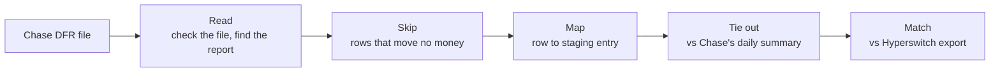
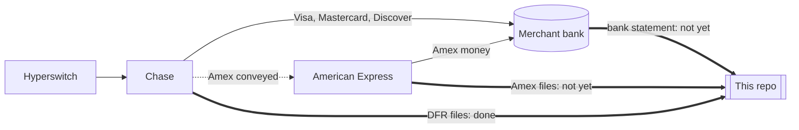

# Chase settlement recon

Rust engines that read Chase's settlement files and reconcile them with Hyperswitch. Each row
becomes a standard staging entry. The engine checks the totals against Chase's own daily summary and
matches the rows with a Hyperswitch export. The same engines run in the browser as WebAssembly,
behind a small dashboard.

- **Chase DFR files** (Paymentech daily reports): deposits (ACT0010), daily summary (FIN0010),
  chargebacks (PDE0017). Checked against a live file: 9,186 of 9,186 rows staged, all totals tie.
- **Amex conveyed:** finds the Amex payments that Amex pays directly, not Chase, and keeps them
  apart from Chase's deposit.
- **Commerce Center CSV reports** (J.P. Morgan): deposit details and fees.

## How it works





## Quick start

Needs Rust (with the `wasm32-unknown-unknown` target), `wasm-bindgen-cli` 0.2.129 and Node.

```
cargo test --workspace          # 87 tests
scripts/build.sh                # builds the site into dist/
python3 -m http.server -d dist  # open http://localhost:8000
```

Or run the engine on one file:

```
cd engines/orbital
cargo run --release -- run samples/0000999999.261005.d.B105.dfr configs/act0010_deposit_detail_live.json --out out
```

## Layout

| Path | What it is |
|---|---|
| `engines/orbital` | Engine for Chase DFR files, with the tie-out. Details in its [README](engines/orbital/README.md). |
| `engines/commerce` | Engine for Commerce Center CSV reports |
| `engines/*/configs` | One JSON config per report: field positions, what to skip, what maps where |
| `engines/*/samples` | Sample files: synthetic DFR files, J.P. Morgan's public CSV samples |
| `wasm` | Both engines as WebAssembly |
| `web/orbital`, `web/commerce` | The dashboards (ReScript + React). The site opens on Orbital. |
| `deploy/` | Cloud Run deploy behind a sign-in |

## Not done yet

- Amex's own settlement file (GRRCN), to match the conveyed Amex payments.
- The bank statement, to confirm each deposit landed.
- A live Hyperswitch export (the samples use mocks).

## Sources

- Chase Paymentech *Delimited File Reporting* spec (2013), for the file layouts. Not included.
- [J.P. Morgan Commerce: preset reports](https://developer.payments.jpmorgan.com/docs/commerce/optimization-protection/capabilities/reporting/preset-reports/overview)
- [active_merchant Orbital gateway](https://github.com/activemerchant/active_merchant): order ID rules
- [Gr4vy: Chase Orbital settlement reports](https://docs.gr4vy.com/guides/dashboard/reports/settlement/chaseorbital)
- [Adyen: external settlement detail report](https://docs.adyen.com/reporting/settlement-reconciliation/transaction-level/external-settlement-detail-report)
- [Finance::AMEX::Transaction](https://metacpan.org/dist/Finance-AMEX-Transaction): Amex file layouts
- [Hyperswitch reconciliation docs](https://docs.hyperswitch.io/other-features/payments-modules/reconciliation-product) and [Control Center](https://github.com/juspay/hyperswitch-control-center)
